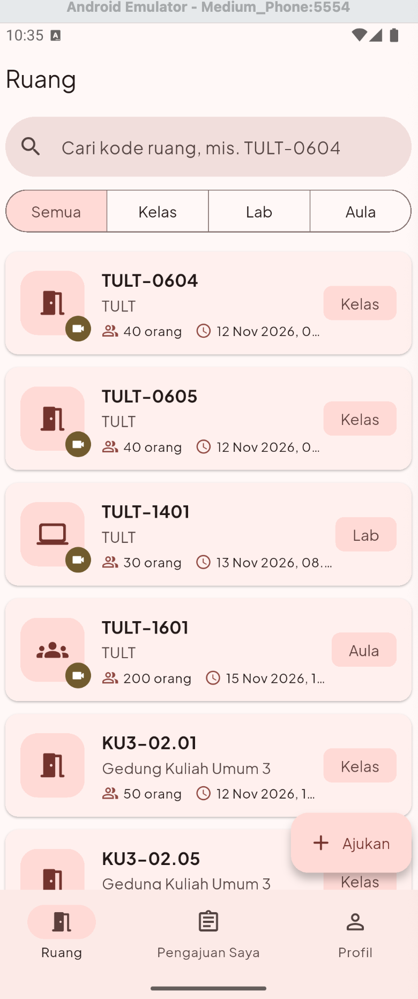
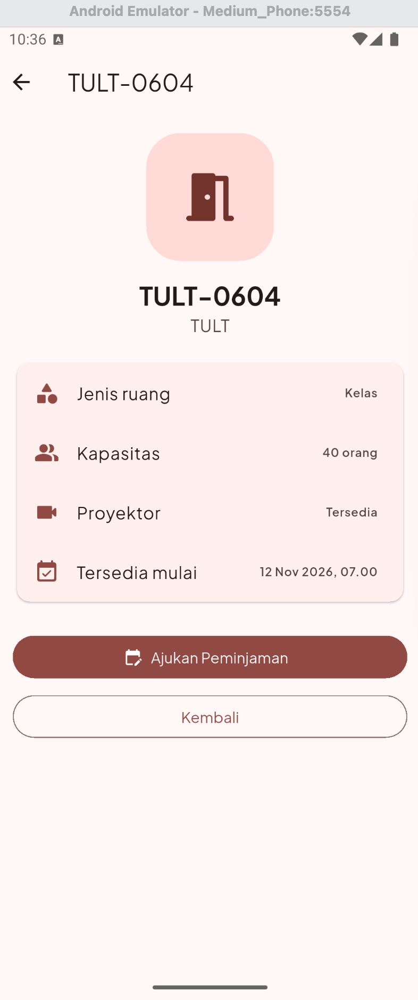
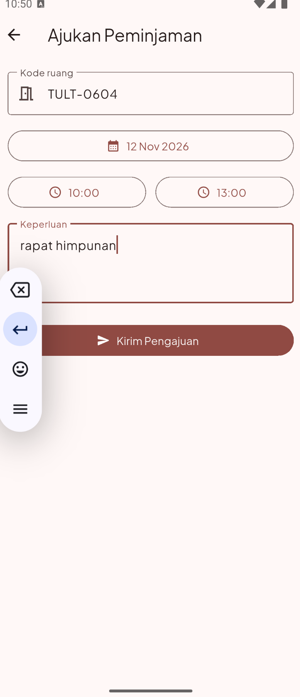
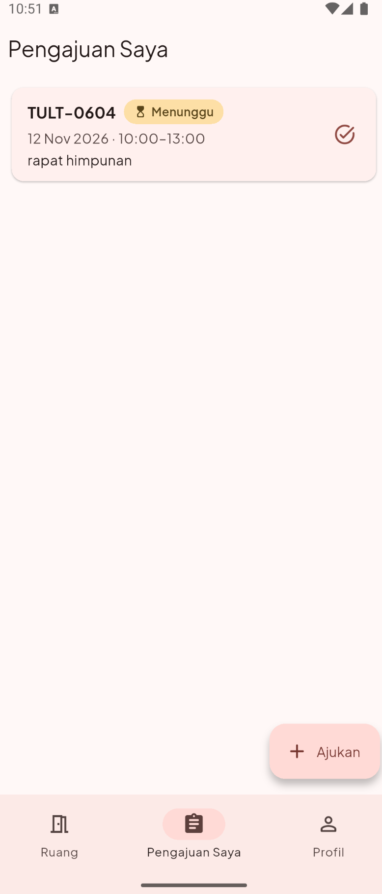

# RuangPinjam — Peminjaman Ruang dan Lab

Proyek UTS Pengembangan Aplikasi Bergerak (BBK4DBB3) · Pertemuan 8

| | |
|---|---|
| **Kelompok** | Kelompok 08 |
| **Tema** | Proyek 2: RuangPinjam (peminjaman ruang dan lab) |
| **Aplikasi** | Flutter (`app/`) + REST API Dart shelf (`server/`) |

## Anggota

| Nama | NIM | Tugas |
|---|---|---|
| Muhammad Alif Mikail Widayaka | 102022300094 | Seluruh pengerjaan (individu): server API, aplikasi Flutter, test, README, video demo |

## Video demo

https://drive.google.com/file/d/1uZ1bwI5jZaNgTvdpe9Z5J7JUwlbsC-uh/view?usp=sharing

## Struktur

```
ruangpinjam/
├─ app/                    # proyek Flutter (id.ac.telkomuniversity.ruang_pinjam)
│  ├─ lib/
│  │  ├─ main.dart, theme.dart, config.dart
│  │  ├─ models/           # ruang.dart, pengajuan.dart
│  │  ├─ services/         # ruang_service.dart (paket http)
│  │  ├─ pages/            # halaman_utama, ruang, detail, form, pengajuan, profil, gedung
│  │  ├─ widgets/          # kartu_ruang.dart, label_status.dart
│  │  └─ utils/            # format.dart
│  ├─ test/                # 6 widget test + 6 test layanan (MockClient)
│  ├─ assets/              # images/, fonts/, icon/
│  └─ pubspec.yaml
├─ server/
│  ├─ bin/server.dart      # shelf + shelf_router
│  └─ data/ruang.json      # 14 ruang
├─ screenshots/
└─ README.md
```

## Cara menjalankan

**1. Nyalakan server** (terminal pertama):

```bash
cd server
dart pub get
dart run bin/server.dart
# RuangPinjam API berjalan di http://0.0.0.0:8080
```

Endpoint:

| Metode | Endpoint | Keterangan |
|---|---|---|
| GET | `/ruang` | Daftar semua ruang (opsional `?jenis=Kelas\|Lab\|Aula`) |
| GET | `/ruang/<id>` | Satu ruang berdasarkan id |
| GET | `/gedung` | **Endpoint khas:** daftar gedung dan jumlah ruangnya |
| POST | `/pengajuan` | Nilai tambah: simpan pengajuan baru |
| GET | `/pengajuan` | Pengajuan yang sudah masuk ke server |

**2. Jalankan aplikasi** (terminal kedua):

```bash
cd app
flutter pub get
# Emulator Android (10.0.2.2 = localhost laptop dari emulator)
flutter run --dart-define=API_URL=http://10.0.2.2:8080
# HP Android fisik (laptop dan HP di Wi-Fi yang sama)
flutter run --dart-define=API_URL=http://<IP-laptop>:8080
```

**3. Analisis dan test:**

```bash
cd app
flutter analyze   # No issues found!
flutter test      # All tests passed! (12 test)
```

**4. APK debug:**

```bash
cd app
flutter build apk --debug --dart-define=API_URL=http://10.0.2.2:8080
```

## Tangkapan layar

| Daftar ruang | Detail ruang | Form pengajuan | Pengajuan saya |
|---|---|---|---|
|  |  |  |  |


## Tabel pemenuhan fitur

Semua path relatif terhadap folder `app/`, kecuali yang diawali `server/`.

### P01 & P02: Proyek dan aplikasi pertama

| Poin | File:baris | Keterangan |
|---|---|---|
| `flutter create --org id.ac.telkomuniversity` | android/app/build.gradle.kts:19 | `applicationId = "id.ac.telkomuniversity.ruang_pinjam"` |
| Nama paket bukan `com.example` | android/app/build.gradle.kts:19 | Paket `id.ac.telkomuniversity.ruang_pinjam` |
| Nama aplikasi di launcher | android/app/src/main/AndroidManifest.xml:3 | `android:label="RuangPinjam"` |
| Berjalan di emulator/HP Android, ≥ 4 screenshot | screenshots/ | Lihat bagian Tangkapan layar |
| `flutter analyze` bersih | — | Hasil: `No issues found!` |

### P03: Widget dasar, input, dan interaksi

| Poin | File:baris | Keterangan |
|---|---|---|
| StatelessWidget buatan sendiri | lib/pages/halaman_profil.dart:8 | `HalamanProfil`, juga `KartuRuang`, `LabelStatus`, `HalamanDetail` |
| StatefulWidget buatan sendiri | lib/pages/halaman_ruang.dart:9 | `HalamanRuang`, juga `HalamanUtama`, `HalamanFormPengajuan` |
| `setState` mengubah tampilan | lib/pages/halaman_ruang.dart:118 | Ganti filter jenis ruang; juga tab di halaman_utama.dart:106 |
| TextField + TextEditingController | lib/pages/halaman_ruang.dart:27 | Kolom pencarian kode ruang |
| Controller di-`dispose` | lib/pages/halaman_ruang.dart:39 | Juga halaman_form_pengajuan.dart:35–36 |
| Tombol Material 3 (≥ 2 jenis) | lib/pages/halaman_detail.dart:82 | `FilledButton`, `OutlinedButton` (:88), `IconButton` (halaman_pengajuan.dart:81), `FloatingActionButton` (halaman_utama.dart:99) |
| ChoiceChip/FilterChip/SegmentedButton | lib/pages/halaman_ruang.dart:112 | `SegmentedButton` Semua/Kelas/Lab/Aula |
| SnackBar | lib/pages/halaman_utama.dart:53 | Konfirmasi pengajuan terkirim; juga validasi form |

### P04: Model, layout, dan navigasi bawah

| Poin | File:baris | Keterangan |
|---|---|---|
| Model ≥ 6 field, ada DateTime dan bool | lib/models/ruang.dart:2 | 7 field: id, kode, gedung, jenis, kapasitas, `adaProyektor` (bool, :8), `tersediaMulai` (DateTime, :9) |
| Kartu buatan sendiri dengan Row, Column, Expanded, Stack | lib/widgets/kartu_ruang.dart:18 | Row :36, Stack :39, Positioned :59, Expanded :75, Column :76 |
| ListView.builder | lib/pages/halaman_ruang.dart:150 | Daftar ruang; juga halaman_pengajuan.dart:45 |
| NavigationBar ≥ 3 tab + IndexedStack | lib/pages/halaman_utama.dart:104 | Tab Ruang, Pengajuan Saya, Profil; IndexedStack di :83 |

### P05: Banyak halaman, async, debugging, dan test

| Poin | File:baris | Keterangan |
|---|---|---|
| Halaman detail menerima objek lewat konstruktor | lib/pages/halaman_detail.dart:11 | `HalamanDetail(ruang: ...)`, dibuka dengan `Navigator.push` di halaman_ruang.dart:66 |
| Form tambah mengembalikan data `Navigator.pop(context, data)` | lib/pages/halaman_form_pengajuan.dart:102 | Mengembalikan objek `Pengajuan` |
| Data diterima dengan `await` dan muncul di daftar | lib/pages/halaman_utama.dart:29 | Ditambahkan ke daftar di :40, tab pindah ke Pengajuan Saya |
| Cek `mounted` setelah `await` | lib/pages/halaman_utama.dart:37 | Juga halaman_ruang.dart:70, halaman_form_pengajuan.dart:49 |
| ≥ 3 widget test, `flutter test` lulus | test/widget_test.dart:14 | 6 widget test (baris 14, 24, 43, 54, 62, 73); total 12 test lulus |

### P06: Tema, font, dan ikon

| Poin | File:baris | Keterangan |
|---|---|---|
| ThemeData + `ColorScheme.fromSeed` warna khas | lib/theme.dart:10 | Seed merah Telkom `0xFFB71C1C` (:4) |
| `darkTheme` | lib/main.dart:25 | `temaGelap`, `ThemeMode.system` |
| Warna dari `Theme.of(context).colorScheme` | lib/widgets/label_status.dart:15 | Tidak ada `Colors.xxx` sama sekali di `lib/` |
| Font kustom | pubspec.yaml:37 | Plus Jakarta Sans dari `assets/fonts/`, dipakai di lib/theme.dart:9 |
| Ikon launcher sendiri (`flutter_launcher_icons`) | pubspec.yaml:20 | Sumber `assets/icon/icon.png`, ikon adaptif Android |
| Gambar aset lokal di pubspec | pubspec.yaml:34 | `logo.png` (halaman_profil.dart:24), `kosong.png` (halaman_pengajuan.dart:30) |

### P07: Web service, HTTP, dan JSON

| Poin | File:baris | Keterangan |
|---|---|---|
| `server/` shelf + shelf_router, ≥ 12 item JSON | server/bin/server.dart:23 | 14 ruang di `server/data/ruang.json` |
| GET daftar item | server/bin/server.dart:23 | `GET /ruang` |
| GET satu item berdasarkan id | server/bin/server.dart:32 | `GET /ruang/<id>`, 404 jika tidak ada |
| GET endpoint khas tema | server/bin/server.dart:41 | `GET /gedung`, dipakai di lib/services/ruang_service.dart:38 |
| Paket `http` | lib/services/ruang_service.dart:11 | `http.Client` disuntikkan lewat konstruktor |
| API_URL dari `--dart-define` | lib/config.dart:3 | `String.fromEnvironment('API_URL')` |
| `fromJson`/`toJson` + konversi DateTime | lib/models/ruang.dart:21 | `DateTime.parse` :29, `toIso8601String` di `toJson` :33 |
| FutureBuilder 3 keadaan | lib/pages/halaman_ruang.dart:125 | Memuat :130, gagal :133 dengan tombol Coba lagi :198, berhasil |
| Test MockClient | test/ruang_service_test.dart:13 | 6 test layanan tanpa server sungguhan |

### Fitur khas tema (Proyek 2)

| Poin | File:baris | Keterangan |
|---|---|---|
| Model `Ruang` sesuai panduan | lib/models/ruang.dart:2 | id, kode, gedung, jenis, kapasitas, adaProyektor, tersediaMulai |
| Tab Ruang · Pengajuan Saya · Profil | lib/pages/halaman_utama.dart:104 | |
| Form pengajuan dengan `showDatePicker` | lib/pages/halaman_form_pengajuan.dart:42 | Ruang, tanggal, jam mulai–selesai, keperluan |
| `showTimePicker` | lib/pages/halaman_form_pengajuan.dart:54 | Jam mulai dan jam selesai, divalidasi |
| SegmentedButton jenis ruang | lib/pages/halaman_ruang.dart:112 | |
| Pencarian kode ruang | lib/pages/halaman_ruang.dart:57 | Tidak peka huruf besar/kecil |
| Status Menunggu/Disetujui berwarna dari colorScheme | lib/widgets/label_status.dart:15 | `primaryContainer` / `tertiaryContainer` |

### Nilai tambah

| Poin | File:baris | Keterangan |
|---|---|---|
| POST form ke server (+5) | lib/services/ruang_service.dart:50 | Dipanggil di halaman_utama.dart:47; server di server/bin/server.dart:57 |
| Pull-to-refresh (+2) | lib/pages/halaman_ruang.dart:141 | `RefreshIndicator` |
| Animasi Hero kartu → detail (+3) | lib/widgets/kartu_ruang.dart:42 | Pasangan di halaman_detail.dart:24 |
